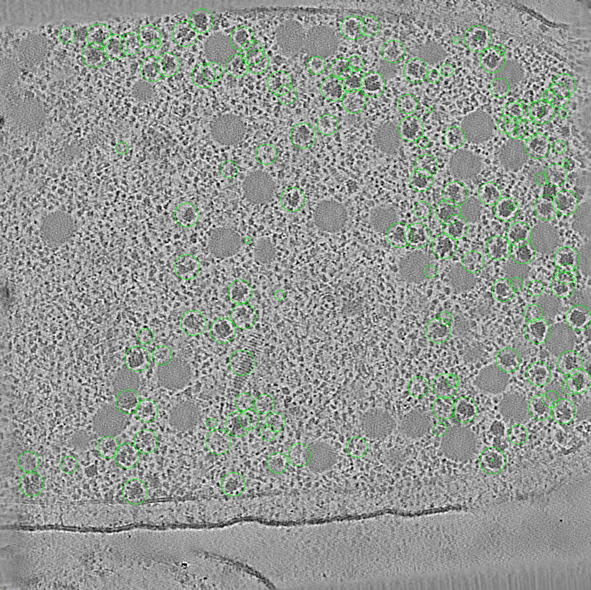

# star2mod

Converts a RELION particle STAR file into an IMOD model (`.mod`). This lets you quickly
check in IMOD that the particle list matches the positions of your particles in the
tomogram, e.g. after extracting particles from template matching. Each particle
becomes a scattered point with a sphere.



*Positions of extracted ribosomes directly after template matching.*

Needs IMOD (`point2model` on `PATH`).

```
pip install -r requirements.txt
python star2mod.py -h
```

## Examples

RELION 5 (`_rlnCenteredCoordinate*Angst`), taking size and voxel size from the
tomogram you will open:

```
python star2mod.py TS_01_particles.star --tomo TS_01_bin4.mrc
3dmod TS_01_bin4.mrc mod/TS_01_particles.mod
```

All `*_particles.star` in the current folder, default tomogram size 1024 × 1024 × 512:

```
python star2mod.py
```

Thicker tomograms:

```
python star2mod.py --dims 1024 1024 680
```

RELION 3/4 (`_rlnCoordinate*`, pixels from the corner), unbinned coordinates on a
bin-4 tomogram:

```
python star2mod.py particles.star --coord_scale 0.25 --angpix 5.4
```

## Notes

- The voxel size must be that of the **tomogram you view**: tilt-series pixel size
  times binning. Taken from `--angpix`, else the `--tomo` header, else
  `_rlnTomoTiltSeriesPixelSize` (particles or optics table) × `--binning` (default 1).
  With `--tomo`, the script reports the binning implied by the STAR file.
- `_rlnOrigin*Angst` shifts from refinement are applied, so refined particles sit on
  their refined centres.
- A STAR file with several tomograms (`_rlnTomoName`) gives one model per tomogram.
- Points outside the tomogram are reported; if all of them are, the voxel size or
  binning is wrong.
- `--sphere` sets the display radius in voxels (default 5; 0 for plain points).

## Outputs (in `--outdir`, default `mod/`)

- `<name>.mod`: IMOD model, scattered points
- `<name>.txt`: the point list in tomogram voxels (X Y Z)
